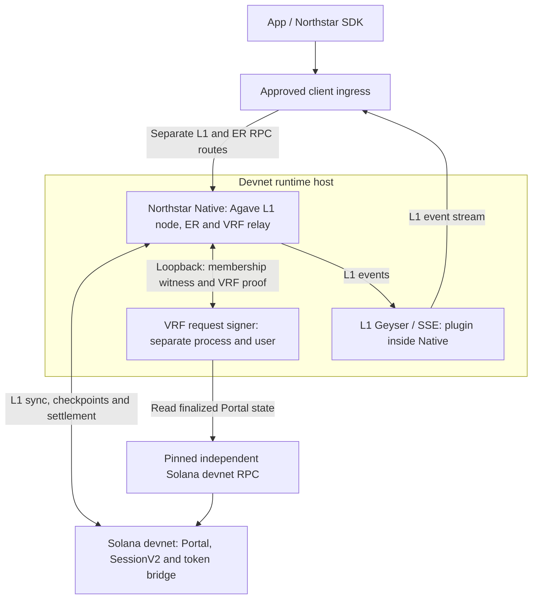

# Northstar devnet ER architecture

This is the infrastructure handoff for the deployed continuity-v2 Ephemeral
Rollup (ER) and its on-chain VRF callbacks. It describes the services and their
boundaries, not an installation procedure. The [Compose reference](../deploy/er-stack/README.md)
is not the hosted deployment. It does not provision ingress, the L1 event
stream, or monitoring.

## Runtime topology

- **Solana L1** holds the canonical session, delegation, custody, and settlement
  state. Clients submit session, delegation, and deposit transactions to devnet
  L1; they submit rollup execution and VRF requests to ER. The validator derives
  ER state from authorized L1 inputs and posts and settles checkpoints via Portal.
- **Northstar Native** (`northstar-validator.service`) is one stateful Agave
  process, not separate L1 and ER validators. It follows Solana devnet, hosts
  ER and the remote-only VRF relay, and runs the L1 Geyser plugin. Geyser serves
  L1 events as server-sent events (SSE); it is not the relay's request source.
  Build the plugin and validator together because the plugin ABI depends on the
  validator and compiler version.
- **The request signer** (`northstar-vrf-request-signer.service`) holds the VRF seed
  and its own admission journal. Native has its validator identity, a separate
  funded fulfillment wallet, and the transport bearer. The signer has the
  matching bearer but no wallet for submitting fulfillment. Host administration
  remains trusted; this is not a threshold signer or independent hardware custody.
- **The SP1/CUDA prover** is an optional lab worker, outside the deployed path.
  Continuity-v2 does not support the experimental execution-proof coordinator.
  The VRF signer makes ordinary CPU VRF proofs; it does not use this worker.
  GPU unavailability must not gate validator or VRF readiness.

## How a VRF request completes

1. The app sends a request on ER. A confirmed ER receipt is local acknowledgement,
   not L1 settlement or authorization to sign.
2. The Native relay finds the request in the accepted ER lineage and sends an
   exact checkpoint membership witness to the signer over authenticated loopback.
   The signer checks the pinned session, program identities and policy, and
   independently verifies membership in a **settled Portal checkpoint on
   finalized L1**. If that check cannot pass, there is no local signing fallback.
3. Native uses the fulfillment wallet to submit the proof on ER. The Coordinator
   invokes the Bai verifier and then the allowed consumer callback on ER. The
   completion check is a successful ER receipt, matching output and a closed
   request. That does not establish L1 settlement of the callback result.

Allow for checkpoint settlement, L1 finality and delivery in request deadlines.
The standalone L1 coin-flip worker and off-chain HTTP VRF API are separate
profiles; neither is the ER signer's endpoint or fallback.

## Network and state boundaries

These are internal listener roles, not public service addresses. Verify the
actual bindings against the retained release before provisioning ingress.

| Interface | Expected boundary |
| --- | --- |
| Native L1 JSON-RPC `8899/TCP`, PubSub `8900/TCP` | Loopback backends. If served to clients, proxy as L1, not ER. Size index and history retention for the workload. |
| ER JSON-RPC `8910/TCP`, PubSub `8911/TCP`, TPU `8912/UDP` | Native binds wildcard addresses. Expose only through approved proxy paths or allowlists; enable TPU ingress only if needed. |
| L1 Geyser SSE `9101/TCP` | Release-managed listener binds wildcard and provides no TLS or client authentication. Restrict reachability; configure TLS, access control, and reconnect/backfill with the L1 RPC. |
| VRF signer `127.0.0.1:9030/TCP` | Bearer-authenticated Native-to-signer traffic only. Do not expose it at the edge. Signer egress uses the pinned `https://api.devnet.solana.com/` authority, not Native's own RPC. |

Size durable SSD storage for the L1 ledger, snapshots and indexes. Preserve ER
lineage, checkpoint plans, unsettled state, relay delivery journal, and signer
admissions as distinct state. Retain the release controls, pinned session and
policies, artifact hashes, and corresponding credentials with the recovery plan.
Keep one active writer per identity and state directory. A replacement must
fence the old writer and reconcile retained state against finalized L1 before
resuming. Do not recreate missing journals, start two writers, or assume an older
binary can read newer lineage. Treat backups as unqualified until a restore has
been rehearsed at a consistent recovery point.

## DevOps handoff

The existing guarded release workflows own Native and signer activation. Keep
infrastructure automation from starting, upgrading or resetting those services
independently. Check the signer policy before activating the relay. Native must
catch up to devnet and recover the pinned SessionV2 lineage before the rollup
can serve that session. Have operators reconcile any interrupted release.

For the infrastructure handoff, cover:

- **Host and ingress:** capacity, local disks, DNS and TLS, firewall and devnet
  peer reachability, separate L1 and ER routes, SSE/WS support, credential delivery
  and restricted access to logs and backups. Run the optional proof lab separately
  with its own GPU, proof workspace and artifact/cache retention.
- **Health and progress:** monitor process status and restarts, L1 finalized slot
  lag relative to devnet, ER RPC reachability, age of pending checkpoints and
  settlement progress, quarantine, storage headroom and fsync errors. ER history
  is transaction-driven; missing empty ER blocks is not a liveness failure.
- **VRF and events:** privately check authenticated signer `/v1/info` against the
  expected policy and key. Observe pending request age, expiry, delivery failures,
  fulfiller balance and signer capacity. Keep credentials out of metrics and logs.
  Check SSE delivery through ingress, not just `/health`. SSE replay is in memory;
  clients must reconnect and backfill from L1 RPC after a gap.
- **Qualification and recovery:** set owners, alert thresholds and retention; choose
  a budgeted, authorized ER callback canary. Measure ER acknowledgement, L1
  eligibility, and ER callback completion separately. Compare exact release and
  policy bindings before restarting after an incident; stop and reconcile unknown
  outcomes rather than replaying a release or deleting state.

## Evidence and detailed references

- The [retained Native upgrade](https://github.com/mirrorworld-universe/northstar/actions/runs/44652164641)
  reports L1 SSE readiness and the retained ER relay. A [separate SDK callback qualification](https://github.com/mirrorworld-universe/vrf-oracle/actions/runs/44737231261)
  on the same Native revision verified the on-chain VRF verifier invocation,
  matching output, and request closure. Neither result establishes soak or SP1
  qualification.
- [Native rollout and recovery](../../.github/scripts/continuity-v2-rollout.md),
  [VRF relay](../vrf-relay/README.md), and the
  [signer rollout](https://github.com/mirrorworld-universe/vrf-oracle/blob/main/deploy/ISOLATED-ER.md)
  describe the release and custody boundaries.
- [L1 Geyser and replay behavior](../geyser-events/README.md),
  [read-only VRF telemetry](../../docs/vrf-qualification-telemetry.md), and
  [continuity-v2 proof limitations](checkpoint-continuity-v2-runtime.md#remaining-deployment-gates).
